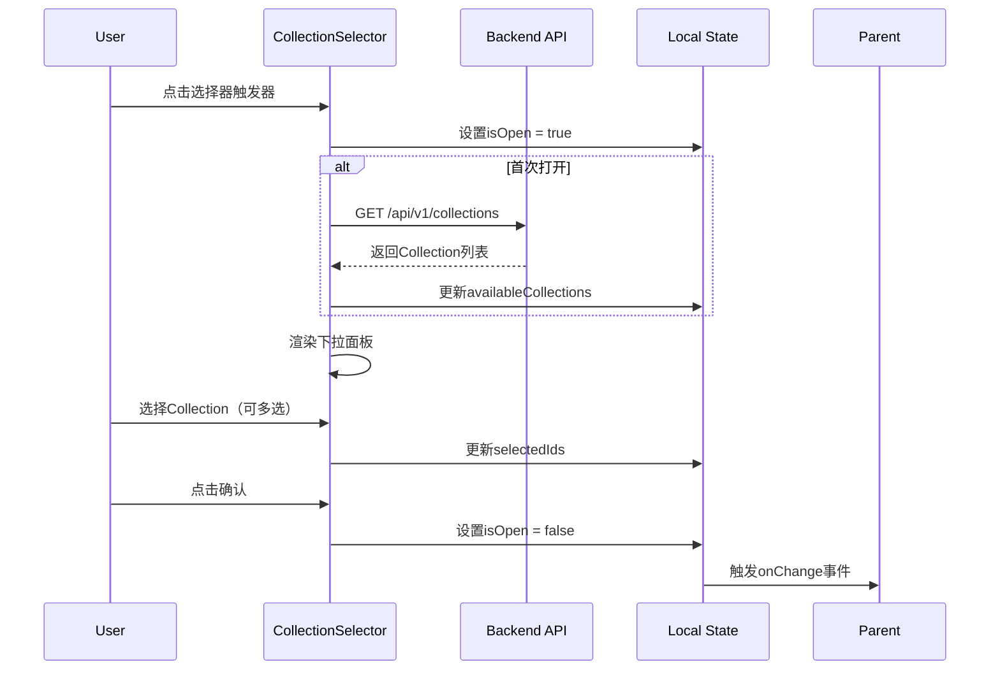

# 多Collection RAG系统详细设计文档（LLD）

## 文档信息

| 属性 | 内容 |
|------|------|
| 文档版本 | V1.0 |
| 创建日期 | 2026-03-31 |
| 文档类型 | 低层次设计（LLD） |
| 状态 | 草稿 |

---

## 第一章 系统概述

### 1.1 项目背景

本项目旨在设计并开发一个具备多Collection功能的检索增强生成（RAG）系统，同时实现一个支持Collection配置的交互式聊天窗口界面。该系统基于现有的RAG知识库系统设计文档，针对多租户、多知识库隔离等场景进行了功能扩展和架构优化。

项目核心需求来源于实际业务场景中对于知识管理、文档检索、智能问答等方面的迫切需求。传统的单Collection架构难以满足复杂业务场景下不同部门、不同项目对知识隔离和共享的需求，因此需要设计一套完整的多Collection架构解决方案。

### 1.2 系统目标

本系统需要实现以下核心目标：第一，提供完整的Collection生命周期管理能力，支持Collection的创建、配置、监控和归档；第二，实现灵活的多租户隔离机制，支持基于组织（租户）的数据隔离；第三，实现灵活的Collection访问控制机制，支持基于用户、角色、部门的多维度权限管理；第四，提供直观的交互式聊天窗口，支持单选和多选Collection进行联合检索；第五，构建完善的管理控制台，支持管理员对系统资源和Collection进行可视化配置；第六，保证系统的高可用性和可扩展性，能够应对大规模并发访问场景。

### 1.3 设计原则

系统设计遵循以下核心原则：模块化原则确保各功能模块之间保持低耦合、高内聚，便于独立开发和测试；可扩展原则在架构设计时预留充分的扩展接口，支持未来功能升级和性能扩容；安全性原则将安全控制贯穿于整个系统设计，从身份认证、权限校验到数据隔离全方位保障系统安全；性能优先原则在关键路径上进行充分的性能优化，确保用户体验流畅；可观测性原则建立完善的监控、告警和日志体系，便于问题定位和系统运维；租户隔离原则确保不同租户之间的数据严格隔离，保障数据安全。

---

## 第二章 技术架构

### 2.1 整体架构

系统采用前后端分离架构，后端基于Spring Boot 3.x构建，前端采用现代前端框架实现。整体架构分为五个主要层次：接入层负责处理外部请求，包括API网关、反向代理和负载均衡；应用层实现业务逻辑，包括Collection管理、RAG服务、权限控制等功能模块；数据层负责数据的持久化存储，包括关系型数据库、向量数据库和对象存储；支撑层提供系统运行的基础服务，包括Redis缓存、消息队列和定时任务；基础设施层涵盖容器编排、容器镜像仓库和持续集成/持续部署流水线。

前端应用作为独立的单页应用（SPA）部署，通过Nginx或其他反向代理服务器访问后端API服务。这种架构模式使得前后端可以独立开发和部署，提高了开发效率和系统可维护性。前端与后端之间通过RESTful API进行数据交互，配合JWT Token进行身份认证和会话管理。

### 2.2 技术栈详情

根据系统运行环境配置文件和版本信息，系统采用以下技术组件构建：

| 组件类别 | 组件名称 | 版本号 | 用途说明 |
|----------|----------|--------|----------|
| 运行时环境 | Redis | 8.4.0 | 分布式缓存、Session存储、消息队列 |
| 运行时环境 | CUDA | 12.9 | GPU计算加速，支持深度学习模型推理 |
| 运行时环境 | Ollama | 0.13.2 | 本地LLM推理服务框架 |
| 深度学习框架 | PyTorch | 2.9.1+cu129 | 神经网络模型训练与推理 |
| 向量数据库 | Qdrant | 1.16.3 | 高性能向量检索引擎 |
| 分布式存储 | etcd | 3.6.7 | 服务发现、配置中心、分布式锁 |
| 对象存储 | MinIO | RELEASE.2025-09-07 | S3兼容的对象存储服务 |
| OCR识别 | PaddleOCR | 3.2.0 | 文档图像文字识别 |

### 2.3 部署架构

系统采用容器化部署方式，使用Docker和Kubernetes进行服务编排和管理。核心服务组件包括：RAG-API服务作为后端API服务，处理所有业务请求；Qdrant集群提供向量数据的存储和检索服务；Redis集群提供缓存和消息分发服务；MinIO集群提供文档和文件的存储服务；Ollama服务提供本地LLM推理能力；PaddleOCR服务提供文档识别能力。

各服务之间通过网络进行通信，使用服务发现机制实现动态服务注册和负载均衡。数据持久化采用分离存储策略，关系型数据存储在PostgreSQL或MySQL中，向量数据存储在Qdrant中，文件和文档存储在MinIO中。这种分离存储策略能够针对不同类型数据的访问特点进行针对性优化，提高整体系统性能。

### 2.4 多租户架构

#### 2.4.1 租户模型设计

系统采用**逻辑隔离**的租户模型，每个租户（组织/部门）拥有独立的数据空间，租户之间数据完全隔离，资源共享。该模型适用于企业级应用场景，在保证数据安全的同时兼顾资源利用效率。

```
┌─────────────────────────────────────────────────────────────────────────┐
│                           系统架构（多租户视角）                          │
├─────────────────────────────────────────────────────────────────────────┤
│                                                                         │
│  ┌─────────────┐  ┌─────────────┐  ┌─────────────┐  ┌─────────────┐     │
│  │   租户 A    │  │   租户 B    │  │   租户 C    │  │   租户 N    │     │
│  │ (组织A)     │  │ (组织B)     │  │ (组织C)     │  │ (组织N)     │     │
│  ├─────────────┤  ├─────────────┤  ├─────────────┤  ├─────────────┤     │
│  │ Collections │  │ Collections │  │ Collections │  │ Collections │     │
│  │ Documents   │  │ Documents   │  │ Documents   │  │ Documents   │     │
│  │ Users       │  │ Users       │  │ Users       │  │ Users       │     │
│  │ ChatHistory │  │ ChatHistory │  │ ChatHistory │  │ ChatHistory │     │
│  └──────┬──────┘  └──────┬──────┘  └──────┬──────┘  └──────┬──────┘     │
│         │                │                │                │            │
│         └────────────────┴────────────────┴────────────────┘            │
│                               │                                         │
│                               ▼                                         │
│                    ┌─────────────────────┐                              │
│                    │   共享基础设施层     │                              │
│                    │  PostgreSQL (逻辑隔离)│                             │
│                    │  Qdrant (租户过滤)   │                              │
│                    │  MinIO (Bucket隔离) │                              │
│                    │  Redis (租户分区)   │                              │
│                    └─────────────────────┘                              │
└─────────────────────────────────────────────────────────────────────────┘
```

#### 2.4.2 租户隔离策略

| 隔离层级 | 隔离方式 | 实现机制 |
|----------|----------|----------|
| 数据库层 | 逻辑隔离 | tenant_id外键约束 + WHERE条件自动过滤 |
| 应用层 | 租户上下文 | ThreadLocal存储租户ID，Service层自动注入 |
| API层 | 租户校验 | JWT Token携带tenantId，请求入口校验 |
| 存储层 | 目录隔离 | MinIO Bucket/目录prefix按租户划分 |
| 向量层 | 元数据过滤 | Qdrant通过payload tenant_id过滤 |

#### 2.4.3 租户上下文传递机制

```java
public class TenantContext {
    private static final ThreadLocal<String> CURRENT_TENANT = new ThreadLocal<>();
    
    public static void setTenantId(String tenantId) {
        CURRENT_TENANT.set(tenantId);
    }
    
    public static String getTenantId() {
        return CURRENT_TENANT.get();
    }
    
    public static void clear() {
        CURRENT_TENANT.remove();
    }
}

@Service
public class TenantAspect {
    @Pointcut("@annotation(org.springframework.web.bind.annotation.RestController)")
    public void controllerPointcut() {}
    
    @Around("controllerPointcut()")
    public Object setTenantContext(ProceedingJoinPoint joinPoint) {
        HttpServletRequest request = ((ServletRequestAttributes) 
            RequestContextHolder.getRequestAttributes()).getRequest();
        
        String tenantId = jwtTokenProvider.getTenantIdFromToken(
            request.getHeader("Authorization"));
        
        TenantContext.setTenantId(tenantId);
        try {
            return joinPoint.proceed();
        } finally {
            TenantContext.clear();
        }
    }
}
```

#### 2.4.4 租户识别与路由

租户识别通过以下优先级确定：

1. **URL路径租户标识** - `/api/v1/{tenantId}/collections`（显式租户）
2. **JWT Token租户声明** - Token中包含tenantId字段（推荐）
3. **请求头租户标识** - `X-Tenant-Id`请求头（API网关转发）
4. **域名租户映射** - 根据请求域名解析租户（多域名场景）

```java
public class TenantResolver {
    public String resolveTenantId(HttpServletRequest request) {
        // 1. 检查URL路径参数
        String pathTenant = extractPathTenant(request.getRequestURI());
        if (StringUtils.hasText(pathTenant)) {
            return pathTenant;
        }
        
        // 2. 检查请求头
        String headerTenant = request.getHeader("X-Tenant-Id");
        if (StringUtils.hasText(headerTenant)) {
            return headerTenant;
        }
        
        // 3. 从JWT获取（默认方式）
        Authentication auth = SecurityContextHolder.getContext().getAuthentication();
        if (auth instanceof JwtAuthenticationToken jwtAuth) {
            return jwtAuth.getToken().getClaimAsString("tenantId");
        }
        
        throw new TenantNotFoundException("无法确定租户身份");
    }
}
```

---

## 第三章 Collection数据模型

### 3.1 Collection实体定义

Collection作为RAG系统的核心知识库管理单元，其数据结构设计需要支持灵活的配置选项、生命周期管理以及与其他业务实体的关联。Collection实体的完整定义如下：

```java
public class Collection implements Serializable {
    private UUID id;                      // 唯一标识符
    private String name;                  // Collection名称
    private String description;           // 详细描述
    private CollectionType type;          // Collection类型
    private CollectionConfig config;      // 配置参数
    private CollectionStatus status;       // 运行状态
    private Integer documentCount;         // 文档数量
    private Long chunkCount;              // 分块数量
    private Long totalSize;               // 总大小（字节）
    private UUID tenantId;                // 租户ID（新增）
    private UUID departmentId;            // 所属部门ID
    private UUID createdBy;               // 创建者ID
    private Instant createdAt;           // 创建时间
    private Instant updatedAt;           // 更新时间
    private Instant deletedAt;           // 删除时间（软删除）
}
```

Collection实体的核心字段说明：id字段采用UUID格式，用于系统内部全局唯一引用；name字段支持中英文字符，最长支持128个字符，应当具备业务语义便于用户识别；description字段用于说明Collection的业务用途和数据范围，最长支持1024个字符；type字段标识Collection的用途分类，包括知识库类型（KNOWLEDGE_BASE）、问答类型（QA_PAIRS）、文档摘要类型（DOCUMENT_SUMMARY）等；config字段以JSON格式存储Collection级别的检索参数，包括向量维度、相似度阈值、召回数量等；status字段标识Collection的当前运行状态，包括活跃状态（ACTIVE）、暂停状态（PAUSED）、归档状态（ARCHIVED）等。

### 3.2 Collection类型枚举

```java
public enum CollectionType {
    KNOWLEDGE_BASE("知识库", "通用知识库类型"),
    QA_PAIRS("问答对", "问答对集合类型"),
    DOCUMENT_SUMMARY("文档摘要", "文档摘要集合类型"),
    TECHNICAL_DOCUMENT("技术文档", "技术文档集合类型"),
    PRODUCT_MANUAL("产品手册", "产品手册集合类型"),
    INTERNAL_KNOWLEDGE("内部知识", "企业内部知识库类型")
}
```

### 3.3 Collection状态枚举

```java
public enum CollectionStatus {
    ACTIVE("活跃", "正常运行状态"),
    PAUSED("暂停", "暂停服务状态"),
    ARCHIVED("归档", "已归档不再使用"),
    DELETED("已删除", "标记删除状态"),
    CREATING("创建中", "初始化创建状态"),
    ERROR("异常", "运行异常状态")
}
```

### 3.4 Collection配置参数

```java
public class CollectionConfig implements Serializable {
    // 检索配置
    private RetrievalConfig retrieval;
    
    // 生成配置
    private GenerationConfig generation;
    
    // 分块配置
    private ChunkingConfig chunking;
    
    // 向量配置
    private VectorConfig vector;
}

@Data
public static class RetrievalConfig {
    private Integer topK = 10;                    // 默认召回数量
    private Double similarityThreshold = 0.7;       // 相似度阈值
    private Boolean rerankEnabled = false;        // 是否启用重排序
    private String rerankModel;                   // 重排序模型
    private Boolean queryExpansionEnabled = false; // 是否启用查询扩展
}

@Data
public static class GenerationConfig {
    private Integer maxTokens = 2000;              // 最大生成Token数
    private Double temperature = 0.7;               // 温度参数
    private Double topP = 0.9;                     // Top-P采样参数
    private Boolean streamEnabled = true;          // 是否启用流式输出
    private String systemPrompt;                   // 自定义系统提示词
}

@Data
public static class ChunkingConfig {
    private ChunkingStrategy strategy = ChunkingStrategy.SEMANTIC;
    private Integer chunkSize = 500;               // 分块大小
    private Integer chunkOverlap = 50;             // 分块重叠
    private Integer minChunkLength = 20;           // 最小分块长度
}

@Data
public static class VectorConfig {
    private String embeddingModel = "BGE-large-zh-v1.5";  // 嵌入模型
    private Integer vectorDimension = 1024;              // 向量维度
    private IndexType indexType = IndexType.HNSW;        // 索引类型
}

public enum ChunkingStrategy {
    CHARACTER("字符分块"),
    SENTENCE("句子分块"),
    PARAGRAPH("段落分块"),
    SEMANTIC("语义分块")
}

public enum IndexType {
    FLAT("暴力检索"),
    IVF("倒排索引"),
    HNSW("分层可导航小世界图")
}
```

### 3.5 Collection关联关系

Collection与租户、部门、用户、文档之间存在复杂的关联关系。Collection必须归属于某个租户（tenant），通过tenantId字段关联；同时可以归属于某个部门（department），通过departmentId字段关联。一个用户可以拥有多个Collection的访问权限，一个Collection也可以被多个用户访问。Collection的访问权限通过权限表进行管理，支持按照用户级别和部门级别进行细粒度控制。同样，一个文档可以被添加到多个Collection中，实现数据的复用和跨Collection关联。

```
┌─────────────┐       ┌─────────────┐       ┌─────────────┐
│   Tenant    │ 1   N │ Collection  │ N   1 │  Department  │
│  (租户/组织)  │──────►│             │◄──────│   (部门)     │
└─────────────┘       └──────┬──────┘       └─────────────┘
                             │
                             │ N:M
                             ▼
                      ┌─────────────┐
                      │   Document  │
                      │   (文档)    │
                      └─────────────┘
```

#### 3.5.1 租户实体定义

```java
@Entity
@Table(name = "tenants")
public class Tenant implements Serializable {
    private UUID id;                      // 租户ID
    private String name;                  // 租户名称
    private String code;                  // 租户编码（唯一）
    private String description;           // 描述
    private TenantType type;              // 租户类型
    private TenantStatus status;          // 状态
    private Integer maxCollections;       // 最大Collection数量
    private Integer maxStorage;           // 最大存储空间（GB）
    private Long usedStorage;             // 已使用存储（字节）
    private UUID ownerId;                 // 租户管理员ID
    private Instant createdAt;           // 创建时间
    private Instant updatedAt;           // 更新时间
}

public enum TenantType {
    ENTERPRISE("企业"),        // 企业级租户
    DEPARTMENT("部门"),       // 部门级租户
    PERSONAL("个人")          // 个人租户
}

public enum TenantStatus {
    ACTIVE("活跃"),
    SUSPENDED("暂停"),
    DELETED("已删除")
}
```

---

## 第四章 数据库设计

### 4.1 租户表

```sql
CREATE TABLE tenants (
    id UUID PRIMARY KEY DEFAULT gen_random_uuid(),
    name VARCHAR(128) NOT NULL,
    code VARCHAR(64) NOT NULL UNIQUE,
    description TEXT,
    type VARCHAR(32) NOT NULL DEFAULT 'ENTERPRISE',
    status VARCHAR(32) NOT NULL DEFAULT 'ACTIVE',
    max_collections INTEGER DEFAULT 100,
    max_storage_gb INTEGER DEFAULT 100,
    used_storage BIGINT DEFAULT 0,
    owner_id UUID NOT NULL,
    created_at TIMESTAMP WITH TIME ZONE NOT NULL DEFAULT CURRENT_TIMESTAMP,
    updated_at TIMESTAMP WITH TIME ZONE NOT NULL DEFAULT CURRENT_TIMESTAMP,
    
    CONSTRAINT tenants_code_length CHECK (char_length(code) >= 2 AND char_length(code) <= 64),
    CONSTRAINT tenants_type_check CHECK (type IN ('ENTERPRISE', 'DEPARTMENT', 'PERSONAL')),
    CONSTRAINT tenants_status_check CHECK (status IN ('ACTIVE', 'SUSPENDED', 'DELETED'))
);

CREATE INDEX idx_tenants_code ON tenants(code);
CREATE INDEX idx_tenants_status ON tenants(status);
CREATE INDEX idx_tenants_owner_id ON tenants(owner_id);
```

### 4.2 Collection核心表

```sql
CREATE TABLE collections (
    id UUID PRIMARY KEY DEFAULT gen_random_uuid(),
    name VARCHAR(128) NOT NULL,
    description TEXT,
    type VARCHAR(32) NOT NULL DEFAULT 'KNOWLEDGE_BASE',
    config JSONB NOT NULL DEFAULT '{}',
    status VARCHAR(32) NOT NULL DEFAULT 'ACTIVE',
    document_count INTEGER DEFAULT 0,
    chunk_count BIGINT DEFAULT 0,
    total_size BIGINT DEFAULT 0,
    tenant_id UUID NOT NULL,
    department_id VARCHAR(500),  -- 所属部门（多部门支持：逗号分隔存储多部门ID）
    created_by UUID NOT NULL,
    created_at TIMESTAMP WITH TIME ZONE NOT NULL DEFAULT CURRENT_TIMESTAMP,
    updated_at TIMESTAMP WITH TIME ZONE NOT NULL DEFAULT CURRENT_TIMESTAMP,
    deleted_at TIMESTAMP WITH TIME ZONE,
    
    CONSTRAINT fk_collections_tenant FOREIGN KEY (tenant_id) REFERENCES tenants(id) ON DELETE RESTRICT,
    CONSTRAINT fk_collections_department FOREIGN KEY (department_id) REFERENCES departments(id) ON DELETE SET NULL,
    CONSTRAINT collections_name_length CHECK (char_length(name) >= 1 AND char_length(name) <= 128),
    CONSTRAINT collections_description_length CHECK (description IS NULL OR char_length(description) <= 1024),
    CONSTRAINT collections_status_check CHECK (status IN ('ACTIVE', 'PAUSED', 'ARCHIVED', 'DELETED', 'CREATING', 'ERROR')),
    CONSTRAINT uk_collections_tenant_name UNIQUE (tenant_id, name)
);

CREATE INDEX idx_collections_tenant_id ON collections(tenant_id);
CREATE INDEX idx_collections_name ON collections(name);
CREATE INDEX idx_collections_status ON collections(status);
CREATE INDEX idx_collections_type ON collections(type);
CREATE INDEX idx_collections_created_by ON collections(created_by);
CREATE INDEX idx_collections_created_at ON collections(created_at);
CREATE INDEX idx_collections_department_id ON collections(department_id);
```

### 4.3 Collection文档关联表

```sql
CREATE TABLE collection_documents (
    id UUID PRIMARY KEY DEFAULT gen_random_uuid(),
    collection_id UUID NOT NULL,
    document_id UUID NOT NULL,
    tenant_id UUID NOT NULL,
    added_at TIMESTAMP WITH TIME ZONE NOT NULL DEFAULT CURRENT_TIMESTAMP,
    added_by UUID NOT NULL,
    processing_status VARCHAR(32) NOT NULL DEFAULT 'PENDING',
    processing_priority INTEGER DEFAULT 0,
    processing_error TEXT,
    processed_at TIMESTAMP WITH TIME ZONE,
    
    CONSTRAINT fk_collection_documents_collection 
        FOREIGN KEY (collection_id) REFERENCES collections(id) ON DELETE CASCADE,
    CONSTRAINT fk_collection_documents_tenant 
        FOREIGN KEY (tenant_id) REFERENCES tenants(id) ON DELETE CASCADE,
    CONSTRAINT fk_collection_documents_document 
        FOREIGN KEY (document_id) REFERENCES documents(id) ON DELETE CASCADE,
    CONSTRAINT uk_collection_documents_unique 
        UNIQUE (collection_id, document_id)
);

CREATE INDEX idx_collection_documents_collection_id ON collection_documents(collection_id);
CREATE INDEX idx_collection_documents_tenant_id ON collection_documents(tenant_id);
CREATE INDEX idx_collection_documents_document_id ON collection_documents(document_id);
CREATE INDEX idx_collection_documents_processing_status ON collection_documents(processing_status);
CREATE INDEX idx_collection_documents_added_at ON collection_documents(added_at);
CREATE INDEX idx_collection_documents_added_by ON collection_documents(added_by);
```

### 4.4 Collection权限表

```sql
CREATE TABLE collection_permissions (
    id UUID PRIMARY KEY DEFAULT gen_random_uuid(),
    collection_id UUID NOT NULL,
    tenant_id UUID NOT NULL,
    permission_type VARCHAR(32) NOT NULL,
    grantee_type VARCHAR(32) NOT NULL,
    grantee_id UUID NOT NULL,
    inherited BOOLEAN DEFAULT FALSE,
    created_at TIMESTAMP WITH TIME ZONE NOT NULL DEFAULT CURRENT_TIMESTAMP,
    expires_at TIMESTAMP WITH TIME ZONE,
    
    CONSTRAINT fk_collection_permissions_collection 
        FOREIGN KEY (collection_id) REFERENCES collections(id) ON DELETE CASCADE,
    CONSTRAINT fk_collection_permissions_tenant 
        FOREIGN KEY (tenant_id) REFERENCES tenants(id) ON DELETE CASCADE,
    CONSTRAINT uk_collection_permissions_unique 
        UNIQUE (collection_id, permission_type, grantee_type, grantee_id),
    CONSTRAINT chk_permission_type CHECK (permission_type IN ('READ', 'WRITE', 'ADMIN')),
    CONSTRAINT chk_grantee_type CHECK (grantee_type IN ('USER', 'DEPARTMENT', 'ROLE'))
);

CREATE INDEX idx_collection_permissions_collection_id ON collection_permissions(collection_id);
CREATE INDEX idx_collection_permissions_tenant_id ON collection_permissions(tenant_id);
CREATE INDEX idx_collection_permissions_grantee ON collection_permissions(grantee_type, grantee_id);
```

### 4.5 Collection统计指标表

```sql
CREATE TABLE collection_metrics (
    id UUID PRIMARY KEY DEFAULT gen_random_uuid(),
    collection_id UUID NOT NULL,
    tenant_id UUID NOT NULL,
    metric_type VARCHAR(64) NOT NULL,
    metric_value DECIMAL(20, 6) NOT NULL,
    sample_size INTEGER,
    dimensions JSONB,
    recorded_at TIMESTAMP WITH TIME ZONE NOT NULL DEFAULT CURRENT_TIMESTAMP,
    
    CONSTRAINT fk_collection_metrics_collection 
        FOREIGN KEY (collection_id) REFERENCES collections(id) ON DELETE CASCADE,
    CONSTRAINT fk_collection_metrics_tenant 
        FOREIGN KEY (tenant_id) REFERENCES tenants(id) ON DELETE CASCADE,
    CONSTRAINT chk_metric_type CHECK (metric_type IN (
        'QUERY_COUNT', 'LATENCY_P50', 'LATENCY_P95', 'LATENCY_P99',
        'ERROR_RATE', 'RETRIEVAL_RECALL', 'TOKEN_USAGE', 'USER_COUNT'
    ))
);

CREATE INDEX idx_collection_metrics_collection_id ON collection_metrics(collection_id);
CREATE INDEX idx_collection_metrics_tenant_id ON collection_metrics(tenant_id);
CREATE INDEX idx_collection_metrics_metric_type ON collection_metrics(metric_type);
CREATE INDEX idx_collection_metrics_recorded_at ON collection_metrics(recorded_at);
CREATE INDEX idx_collection_metrics_composite ON collection_metrics(collection_id, metric_type, recorded_at);
```

### 4.6 会话与消息表

```sql
CREATE TABLE chat_sessions (
    id UUID PRIMARY KEY DEFAULT gen_random_uuid(),
    title VARCHAR(256),
    user_id UUID NOT NULL,
    tenant_id UUID NOT NULL,
    collection_ids UUID[] DEFAULT '{}',
    status VARCHAR(32) NOT NULL DEFAULT 'ACTIVE',
    message_count INTEGER DEFAULT 0,
    created_at TIMESTAMP WITH TIME ZONE NOT NULL DEFAULT CURRENT_TIMESTAMP,
    updated_at TIMESTAMP WITH TIME ZONE NOT NULL DEFAULT CURRENT_TIMESTAMP,
    last_message_at TIMESTAMP WITH TIME ZONE,
    
    CONSTRAINT fk_chat_sessions_user FOREIGN KEY (user_id) REFERENCES users(id) ON DELETE CASCADE,
    CONSTRAINT fk_chat_sessions_tenant FOREIGN KEY (tenant_id) REFERENCES tenants(id) ON DELETE CASCADE
);

CREATE TABLE chat_messages (
    id UUID PRIMARY KEY DEFAULT gen_random_uuid(),
    session_id UUID NOT NULL,
    tenant_id UUID NOT NULL,
    role VARCHAR(16) NOT NULL,
    content TEXT NOT NULL,
    sources JSONB DEFAULT '[]',
    query_params JSONB DEFAULT '{}',
    model_info JSONB,
    token_usage JSONB,
    generation_time_ms INTEGER,
    created_at TIMESTAMP WITH TIME ZONE NOT NULL DEFAULT CURRENT_TIMESTAMP,
    
    CONSTRAINT fk_chat_messages_session FOREIGN KEY (session_id) REFERENCES chat_sessions(id) ON DELETE CASCADE,
    CONSTRAINT fk_chat_messages_tenant FOREIGN KEY (tenant_id) REFERENCES tenants(id) ON DELETE CASCADE,
    CONSTRAINT chk_message_role CHECK (role IN ('user', 'assistant', 'system'))
);

CREATE INDEX idx_chat_sessions_user_id ON chat_sessions(user_id);
CREATE INDEX idx_chat_sessions_tenant_id ON chat_sessions(tenant_id);
CREATE INDEX idx_chat_sessions_updated_at ON chat_sessions(updated_at);
CREATE INDEX idx_chat_messages_session_id ON chat_messages(session_id);
CREATE INDEX idx_chat_messages_tenant_id ON chat_messages(tenant_id);
CREATE INDEX idx_chat_messages_created_at ON chat_messages(created_at);
```

---

## 第五章 API接口设计

### 5.1 Collection管理API

#### 5.1.1 创建Collection

```
POST /api/v1/collections
Content-Type: application/json
Authorization: Bearer {token}
```

请求体：

```json
{
  "name": "产品知识库",
  "description": "存放所有产品相关的技术文档和用户手册",
  "type": "KNOWLEDGE_BASE",
  "config": {
    "retrieval": {
      "topK": 10,
      "similarityThreshold": 0.7,
      "rerankEnabled": false,
      "queryExpansionEnabled": false
    },
    "generation": {
      "maxTokens": 2000,
      "temperature": 0.7,
      "streamEnabled": true
    },
    "chunking": {
      "strategy": "SEMANTIC",
      "chunkSize": 500,
      "chunkOverlap": 50
    },
    "vector": {
      "embeddingModel": "BGE-large-zh-v1.5",
      "vectorDimension": 1024
    }
  }
}
```

响应（201 Created）：

```json
{
  "code": 0,
  "message": "success",
  "data": {
    "id": "550e8400-e29b-41d4-a716-446655440000",
    "name": "产品知识库",
    "description": "存放所有产品相关的技术文档和用户手册",
    "type": "KNOWLEDGE_BASE",
    "config": { ... },
    "status": "CREATING",
    "documentCount": 0,
    "chunkCount": 0,
    "totalSize": 0,
    "createdBy": "user-uuid",
    "createdAt": "2026-03-31T10:00:00Z",
    "updatedAt": "2026-03-31T10:00:00Z"
  }
}
```

#### 5.1.2 获取Collection列表

```
GET /api/v1/collections?page=1&pageSize=20&type=KNOWLEDGE_BASE&status=ACTIVE&search=产品&sortBy=createdAt&sortOrder=desc
Authorization: Bearer {token}
```

响应（200 OK）：

```json
{
  "code": 0,
  "message": "success",
  "data": {
    "items": [
      {
        "id": "550e8400-e29b-41d4-a716-446655440000",
        "name": "产品知识库",
        "type": "KNOWLEDGE_BASE",
        "status": "ACTIVE",
        "documentCount": 150,
        "chunkCount": 3200,
        "createdAt": "2026-03-31T10:00:00Z"
      }
    ],
    "totalCount": 25,
    "page": 1,
    "pageSize": 20,
    "totalPages": 2
  }
}
```

#### 5.1.3 获取Collection详情

```
GET /api/v1/collections/{collectionId}
Authorization: Bearer {token}
```

#### 5.1.4 更新Collection

```
PUT /api/v1/collections/{collectionId}
Content-Type: application/json
Authorization: Bearer {token}
```

#### 5.1.5 删除Collection

```
DELETE /api/v1/collections/{collectionId}
Authorization: Bearer {token}
```

### 5.2 Collection文档管理API

#### 5.2.1 添加文档到Collection

```
POST /api/v1/collections/{collectionId}/documents
Content-Type: application/json
Authorization: Bearer {token}
```

请求体：

```json
{
  "documentIds": [
    "doc-uuid-1",
    "doc-uuid-2",
    "doc-uuid-3"
  ],
  "processingPriority": 0
}
```

#### 5.2.2 从Collection移除文档

```
DELETE /api/v1/collections/{collectionId}/documents/{documentId}
Authorization: Bearer {token}
```

#### 5.2.3 获取Collection文档列表

```
GET /api/v1/collections/{collectionId}/documents?page=1&pageSize=20&status=COMPLETED
Authorization: Bearer {token}
```

### 5.3 Collection配置管理API

#### 5.3.1 更新Collection配置

```
PUT /api/v1/collections/{collectionId}/config
Content-Type: application/json
Authorization: Bearer {token}
```

请求体：

```json
{
  "retrieval": {
    "topK": 15,
    "similarityThreshold": 0.75
  },
  "generation": {
    "temperature": 0.8,
    "maxTokens": 3000
  }
}
```

#### 5.3.2 获取Collection统计指标

```
GET /api/v1/collections/{collectionId}/metrics?startDate=2026-03-01&endDate=2026-03-31&metricTypes=QUERY_COUNT,LATENCY_P95
Authorization: Bearer {token}
```

### 5.4 RAG查询API

#### 5.4.1 聊天查询（SSE流式）

```
POST /api/v1/chat/stream
Content-Type: application/json
Authorization: Bearer {token}
```

请求体：

```json
{
  "sessionId": "session-uuid",
  "query": "如何配置系统参数？",
  "collectionIds": ["collection-uuid-1", "collection-uuid-2"],
  "noExpansion": false,
  "topK": 5,
  "similarityThreshold": 0.7
}
```

响应（text/event-stream）：

```
id: 1
event: token
data: {"type":"token","content":"根据"}

id: 2
event: token
data: {"type":"token","content":"检索"}

id: 3
event: source
data: {"type":"source","documentId":"doc-uuid","title":"系统配置手册","snippet":"系统参数配置位于管理后台..."}

id: 4
event: done
data: {"type":"done","messageId":"msg-uuid","tokensUsed":150,"generationTimeMs":2500}
```

#### 5.4.2 非流式查询

```
POST /api/v1/chat/query
Content-Type: application/json
Authorization: Bearer {token}
```

---

## 第六章 聊天窗口设计

### 6.1 组件架构

聊天窗口采用组件化架构设计，各组件职责清晰、边界明确。整体组件树结构如下：

```
ChatContainer（容器组件）
├── ChatHeader（头部组件）
│   ├── CollectionSelector（Collection选择器）
│   ├── SessionSelector（会话选择器）
│   └── WindowControls（窗口控制按钮）
├── MessageArea（消息区域组件）
│   ├── MessageList（消息列表）
│   │   └── MessageBubble（消息气泡）
│   │       ├── UserMessage（用户消息）
│   │       └── AssistantMessage（助手消息）
│   └── TypingIndicator（输入指示器）
├── InputArea（输入区域组件）
│   ├── CollectionToggle（Collection快捷切换）
│   ├── ExpansionToggle（拓展回答开关）
│   ├── TextInput（文本输入框）
│   └── SendButton（发送按钮）
└── SettingsPanel（设置面板）
    ├── UserPreferences（用户偏好）
    └── CollectionDefaults（默认Collection配置）
```

### 6.2 Collection选择器组件

Collection选择器组件支持单选和多选两种模式，界面设计包括下拉选择模式和标签选择模式两种展示方式。

下拉选择模式（DropdownSelector）适用于Collection数量较多（超过10个）的场景。组件状态定义如下：

```typescript
interface CollectionSelectorState {
  isOpen: boolean;                    // 下拉面板是否展开
  selectedIds: string[];              // 选中的Collection ID列表
  availableCollections: Collection[]; // 可选的Collection列表
  searchQuery: string;                // 搜索关键词
  recentIds: string[];                // 最近使用的Collection ID
  loading: boolean;                   // 加载状态
  error: string | null;               // 错误信息
}

interface Collection {
  id: string;
  name: string;
  type: CollectionType;
  documentCount: number;
  status: CollectionStatus;
  hasPermission: boolean;
}
```

组件交互流程：



### 6.3 "无需拓展回答"功能

"无需拓展回答"功能（No-Expansion Mode）控制LLM是否仅基于检索到的上下文生成回答。

#### 6.3.1 功能说明

当用户开启此功能时，AI助手将严格限制在检索结果范围内回答，不会使用自身知识进行补充。这种模式适用于需要严格基于文档内容回答的场景，如合规审查、引用验证等。

#### 6.3.2 前端实现

```typescript
interface ExpansionToggleProps {
  value: boolean;
  onChange: (value: boolean) => void;
  disabled?: boolean;
}

const ExpansionToggle: React.FC<ExpansionToggleProps> = ({
  value,
  onChange,
  disabled = false
}) => {
  const handleToggle = () => {
    if (!disabled) {
      onChange(!value);
      // 保存到用户偏好
      saveUserPreference('noExpansionDefault', !value);
    }
  };

  return (
    <Tooltip 
      title={value 
        ? "AI将仅根据检索到的文档内容回答，不会使用自身知识补充" 
        : "AI可以结合检索内容和自身知识进行综合回答"
      }
    >
      <button 
        className={`expansion-toggle ${value ? 'active' : ''}`}
        onClick={handleToggle}
        disabled={disabled}
      >
        <Icon type={value ? 'lock' : 'unlock'} />
        <span>{value ? '仅文档回答' : '允许拓展'}</span>
      </button>
    </Tooltip>
  );
};
```

#### 6.3.3 后端实现

```java
public class RAGService {
    
    private static final String NO_EXPANSION_PROMPT = 
        "你是一个基于文档的问答助手。请仔细阅读以下检索到的上下文内容，" +
        "并仅基于这些内容回答用户问题。如果上下文中没有足够信息回答问题，" +
        "请明确告知用户，不要编造信息。\n\n上下文：\n{context}\n\n问题：{question}";
    
    private static final String DEFAULT_PROMPT = 
        "你是一个知识丰富的问答助手。请结合以下检索到的上下文内容和你的知识" +
        "来回答用户问题。如果上下文信息不足，可以适当补充相关知识，" +
        "但应明确标注哪些是来自检索内容，哪些是你补充的。\n\n上下文：\n{context}\n\n问题：{question}";
    
    public QueryResult query(QueryRequest request) {
        // 1. 获取Collection配置
        CollectionConfig config = getCollectionConfig(request.getCollectionIds());
        
        // 2. 构建系统提示词
        String systemPrompt = buildSystemPrompt(request.isNoExpansion());
        
        // 3. 检索相关文档
        List<SearchResult> searchResults = vectorStore.search(
            request.getQuery(),
            request.getCollectionIds(),
            request.getTopK(),
            request.getSimilarityThreshold()
        );
        
        // 4. 构建上下文
        String context = buildContext(searchResults);
        
        // 5. 调用LLM生成答案
        String answer = llmService.generate(
            context,
            request.getQuery(),
            systemPrompt,
            config.getGeneration()
        );
        
        // 6. 返回结果
        return QueryResult.builder()
            .answer(answer)
            .sources(searchResults)
            .usedExpansion(!request.isNoExpansion())
            .build();
    }
    
    private String buildSystemPrompt(boolean noExpansion) {
        return noExpansion ? NO_EXPANSION_PROMPT : DEFAULT_PROMPT;
    }
}
```

### 6.4 实时查询处理

#### 6.4.1 流式输出实现

后端使用Server-Sent Events（SSE）实现流式输出：

```java
@RestController
@RequestMapping("/api/v1/chat")
public class ChatController {
    
    @PostMapping("/stream")
    public Flux<ServerSentEvent> streamQuery(@RequestBody QueryRequest request,
                                              @AuthenticationPrincipal User user) {
        return ragService.streamQuery(request, user)
            .map(token -> ServerSentEvent.builder()
                .id(UUID.randomUUID().toString())
                .event("token")
                .data("{\"type\":\"token\",\"content\":\"" + escapeJson(token) + "\"}")
                .build())
            .concatWith(Flux.fromCallable(() -> buildDoneEvent()));
    }
    
    private ServerSentEvent buildSourceEvent(SearchResult source) {
        String data = String.format(
            "{\"type\":\"source\",\"documentId\":\"%s\",\"title\":\"%s\",\"snippet\":\"%s\"}",
            source.getDocumentId(),
            escapeJson(source.getTitle()),
            escapeJson(source.getSnippet())
        );
        return ServerSentEvent.builder()
            .event("source")
            .data(data)
            .build();
    }
    
    private ServerSentEvent buildDoneEvent() {
        return ServerSentEvent.builder()
            .event("done")
            .data("{\"type\":\"done\",\"messageId\":\"" + UUID.randomUUID() + "\"}")
            .build();
    }
}
```

#### 6.4.2 前端处理

```typescript
class ChatService {
  async streamQuery(request: QueryRequest): Promise<void> {
    const response = await fetch('/api/v1/chat/stream', {
      method: 'POST',
      headers: {
        'Content-Type': 'application/json',
        'Authorization': `Bearer ${this.token}`
      },
      body: JSON.stringify(request)
    });

    const reader = response.body.getReader();
    const decoder = new TextDecoder();
    let buffer = '';

    while (true) {
      const { done, value } = await reader.read();
      if (done) break;

      buffer += decoder.decode(value, { stream: true });
      const lines = buffer.split('\n');
      buffer = lines.pop() || '';

      for (const line of lines) {
        if (line.startsWith('data: ')) {
          const data = JSON.parse(line.substring(6));
          this.handleStreamEvent(data);
        }
      }
    }
  }

  private handleStreamEvent(event: StreamEvent): void {
    switch (event.type) {
      case 'token':
        this.onTokenReceived(event.content);
        break;
      case 'source':
        this.onSourceReceived(event);
        break;
      case 'error':
        this.onError(event.message);
        break;
      case 'done':
        this.onStreamComplete(event);
        break;
    }
  }
}
```

---

## 第七章 管理控制台设计

### 7.1 概览仪表盘

概览仪表盘展示系统整体运行状态和关键性能指标，采用卡片式布局设计，包含以下核心指标卡片：

| 指标类型 | 指标名称 | 数据格式 | 更新频率 |
|----------|----------|----------|----------|
| 实时指标 | 总查询量 | 今日累计：{n}次 | 每分钟 |
| 实时指标 | 平均响应时间 | P50: {n}ms / P95: {n}ms | 每分钟 |
| 实时指标 | 错误率 | {n}% | 每分钟 |
| 实时指标 | 活跃Collection数 | {n}个 | 每5分钟 |
| 统计指标 | Token消耗 | 本月：{n}K | 每日更新 |
| 统计指标 | 活跃用户数 | 本周：{n}人 | 每日更新 |

### 7.2 Collection创建向导

创建向导采用Step步骤条组件，分为六个步骤完成Collection的创建和配置。

#### 7.2.1 步骤一：基本信息

```vue
<template>
  <el-form :model="form" :rules="rules" ref="basicForm">
    <el-form-item label="Collection名称" prop="name">
      <el-input 
        v-model="form.name" 
        placeholder="请输入Collection名称"
        maxlength="128"
        show-word-limit
      />
    </el-form-item>
    
    <el-form-item label="类型" prop="type">
      <el-select v-model="form.type" placeholder="请选择类型">
        <el-option
          v-for="type in collectionTypes"
          :key="type.value"
          :label="type.label"
          :value="type.value"
        />
      </el-select>
    </el-form-item>
    
    <el-form-item label="描述" prop="description">
      <el-input
        v-model="form.description"
        type="textarea"
        :rows="4"
        placeholder="请输入Collection描述"
        maxlength="1024"
      />
    </el-form-item>
  </el-form>
</template>

<script setup lang="ts">
const form = reactive({
  name: '',
  type: 'KNOWLEDGE_BASE',
  description: ''
});

const rules = {
  name: [
    { required: true, message: '请输入Collection名称', trigger: 'blur' },
    { min: 1, max: 128, message: '长度在 1 到 128 个字符', trigger: 'blur' }
  ],
  type: [
    { required: true, message: '请选择Collection类型', trigger: 'change' }
  ]
};

const collectionTypes = [
  { value: 'KNOWLEDGE_BASE', label: '知识库' },
  { value: 'QA_PAIRS', label: '问答对' },
  { value: 'DOCUMENT_SUMMARY', label: '文档摘要' },
  { value: 'TECHNICAL_DOCUMENT', label: '技术文档' },
  { value: 'PRODUCT_MANUAL', label: '产品手册' },
  { value: 'INTERNAL_KNOWLEDGE', label: '内部知识' }
];
</script>
```

#### 7.2.2 步骤二至五：配置参数

后续步骤提供检索配置、生成配置、分块配置和向量配置的可视化配置界面，每个配置项配有Tooltip说明，帮助用户理解各参数的作用和推荐值。

### 7.3 目录选择器组件

目录选择器支持从本地文件系统和MinIO对象存储两种目录模式中选择文档：

```typescript
interface DirectorySelectorProps {
  mode: 'local' | 'minio';
  collectionId?: string;
  onConfirm: (selectedFiles: FileItem[]) => void;
}

interface FileItem {
  id: string;
  name: string;
  path: string;
  size: number;
  type: string;
  modifiedAt: Date;
  selected: boolean;
}

@Component
export class DirectorySelector extends Vue {
  @Prop() mode!: 'local' | 'minio';
  
  private currentPath = '/';
  private files: FileItem[] = [];
  private selectedFiles: Set<string> = new Set();
  private loading = false;
  private minioConfig: MinioConfig | null = null;

  async loadDirectory(path: string): Promise<void> {
    this.loading = true;
    try {
      if (this.mode === 'local') {
        const response = await api.listLocalDirectory(path);
        this.files = response.data;
      } else {
        const response = await api.listMinioObjects(this.minioConfig!, path);
        this.files = response.data;
      }
      this.currentPath = path;
    } finally {
      this.loading = false;
    }
  }

  toggleFileSelection(file: FileItem): void {
    if (this.selectedFiles.has(file.id)) {
      this.selectedFiles.delete(file.id);
    } else {
      this.selectedFiles.add(file.id);
    }
  }
}
```

---

## 第八章 安全与权限设计

### 8.1 权限层级体系

系统采用四级角色体系配合三级文档访问权限的矩阵式权限管理模型。

| 角色层级 | 角色标识 | Collection操作权限 | 文档操作权限 |
|----------|----------|---------------------|--------------|
| 系统管理员 | SYSTEM_ADMIN | 创建、编辑、删除、配置所有Collection | 上传、删除、查看所有文档 |
| 部门管理员 | DEPT_ADMIN | 管理本部门所有Collection | 管理本部门所有文档 |
| 上传者 | UPLOADER | 创建个人Collection | 上传和管理自己的文档 |
| 普通人员 | VIEWER | 只读访问授权Collection | 只读访问授权文档 |

### 8.2 权限验证流程

```java
@Component
public class CollectionPermissionInterceptor {
    
    @Autowired
    private PermissionService permissionService;
    
    public void checkPermission(String collectionId, PermissionType required) {
        User currentUser = SecurityContext.getCurrentUser();
        
        // 1. 检查系统管理员权限
        if (currentUser.hasRole(Role.SYSTEM_ADMIN)) {
            return;
        }
        
        // 2. 查询Collection级别权限
        boolean hasPermission = permissionService.checkCollectionPermission(
            currentUser.getId(),
            collectionId,
            required
        );
        
        if (!hasPermission) {
            throw new AccessDeniedException(
                "用户 [" + currentUser.getUsername() + "] 缺乏 Collection [" + collectionId + "] 的 [" + required + "] 权限"
            );
        }
        
        // 3. 记录审计日志
        auditLogService.log(
            AuditAction.ACCESS_COLLECTION,
            currentUser.getId(),
            collectionId,
            required
        );
    }
}
```

### 8.3 数据隔离策略

数据隔离从存储层和访问层两个维度进行设计。存储隔离方面，每个Collection的文档存储在独立的MinIO Bucket或独立目录prefix下；向量数据通过Collection ID进行逻辑隔离，物理上可以共享向量库但通过metadata过滤；数据库表通过collection_id外键关联实现逻辑隔离；敏感配置采用加密存储，每个Collection使用独立的加密密钥。访问隔离方面，API网关层进行请求路由和初步权限校验；业务逻辑层进行细粒度的Collection访问权限验证；数据访问层通过Repository模式的query方法自动添加Collection ID过滤条件；响应返回前进行数据脱敏处理。

---

## 第九章 性能优化设计

### 9.1 向量检索优化

向量检索优化策略包括：采用HNSW（Hierarchical Navigable Small World）索引替代FLAT索引，在召回精度损失可接受的前提下大幅提升检索速度；根据数据规模动态调整HNSW参数（ef_construction、M、ef_search等）；对于数据量小于10万的Collection，可以采用FLAT索引获得100%召回率；定期执行索引重建保持索引效率。

```yaml
# Qdrant Collection配置示例
collection_config:
  vectors:
    size: 1024
    distance: Cosine
  hnsw_config:
    m: 16
    ef_construct: 128
    full_scan_threshold: 10000
  optimizers_config:
    default_segment_number: 4
    indexing_threshold: 20000
```

### 9.2 缓存优化策略

缓存优化策略包括：Redis缓存Collection的基本信息和配置参数，TTL设置为1小时；Redis缓存热门查询的Top-K结果，TTL设置为5分钟；缓存预热机制在系统低峰期预加载高频Collection的索引到内存；采用缓存失效策略，当Collection配置变更或文档更新时主动清除相关缓存。

```java
@Service
public class CollectionCacheService {
    
    private static final String COLLECTION_KEY_PREFIX = "collection:";
    private static final String QUERY_CACHE_PREFIX = "query_cache:";
    private static final Duration COLLECTION_CACHE_TTL = Duration.ofHours(1);
    private static final Duration QUERY_CACHE_TTL = Duration.ofMinutes(5);
    
    public Collection getCollection(String collectionId) {
        String key = COLLECTION_KEY_PREFIX + collectionId;
        Collection cached = redisTemplate.opsForValue().get(key);
        if (cached != null) {
            return cached;
        }
        
        Collection collection = collectionRepository.findById(collectionId)
            .orElseThrow(() -> new CollectionNotFoundException(collectionId));
        redisTemplate.opsForValue().set(key, collection, COLLECTION_CACHE_TTL);
        return collection;
    }
    
    public void invalidateCollection(String collectionId) {
        String key = COLLECTION_KEY_PREFIX + collectionId;
        redisTemplate.delete(key);
    }
}
```

### 9.3 LLM生成优化

LLM生成优化策略包括：确保LLM服务的流式输出能力正常开启；优化首Token时间，通过模型预热、KV Cache等技术加速；控制Token生成速度在合理范围内（每秒15-30个Token）；精简系统提示词，移除不必要的指令和示例；利用检索结果的摘要而非完整文本，减少输入Token数量；实现Prompt缓存，相同配置的请求复用Prompt编译结果。

### 9.4 多Collection查询合并策略

当用户同时选择多个Collection进行联合检索时，需要解决跨Collection的查询合并问题。系统采用**分层合并**策略，在保证检索质量的同时优化查询性能。

#### 9.4.1 查询流程设计

```
用户查询
   │
   ▼
┌─────────────────────────────────────────────────────────────┐
│                    多Collection查询流程                       │
├─────────────────────────────────────────────────────────────┤
│                                                             │
│  ┌──────────────┐    ┌──────────────┐    ┌──────────────┐  │
│  │ Collection-1│    │ Collection-2│    │ Collection-N │  │
│  │   向量检索   │    │   向量检索   │    │   向量检索   │  │
│  └──────┬───────┘    └──────┬───────┘    └──────┬───────┘  │
│         │                   │                   │          │
│         └───────────────────┴───────────────────┘          │
│                         │                                    │
│                         ▼                                    │
│              ┌──────────────────────┐                       │
│              │   结果归一化处理      │                       │
│              │  1. 相似度分数校准    │                       │
│              │  2. 来源标注          │                       │
│              │  3. 去重处理         │                       │
│              └──────────┬───────────┘                       │
│                         │                                    │
│                         ▼                                    │
│              ┌──────────────────────┐                       │
│              │   排序与截断          │                       │
│              │  按分数排序 → topK   │                       │
│              └──────────┬───────────┘                       │
│                         │                                    │
│                         ▼                                    │
│              ┌──────────────────────┐                       │
│              │   返回最终结果        │                       │
│              └──────────────────────┘                       │
└─────────────────────────────────────────────────────────────┘
```

#### 9.4.2 相似度分数校准算法

不同Collection可能使用不同的向量模型或配置参数，导致相似度分数不可直接比较。系统采用**相对校准**方法：

```java
@Service
public class MultiCollectionSearchService {
    
    public List<SearchResult> mergeSearchResults(List<CollectionSearchResult> results) {
        // 1. 对每个Collection的结果进行分数归一化
        List<NormalizedResult> normalized = results.stream()
            .map(this::normalizeScores)
            .flatMap(List::stream)
            .collect(Collectors.toList());
        
        // 2. 按归一化分数排序
        normalized.sort(Comparator.comparing(NormalizedResult::getScore).reversed());
        
        // 3. 去重处理（基于documentId）
        List<NormalizedResult> deduplicated = deduplicateByDocumentId(normalized);
        
        // 4. 截取topK返回
        return deduplicated.stream()
            .limit(request.getTopK())
            .map(this::toSearchResult)
            .collect(Collectors.toList());
    }
    
    private List<NormalizedResult> normalizeScores(CollectionSearchResult result) {
        // 获取该Collection的分数范围
        double maxScore = result.getResults().stream()
            .mapToDouble(SearchResult::getScore)
            .max()
            .orElse(1.0);
        
        double minScore = result.getResults().stream()
            .mapToDouble(SearchResult::getScore)
            .min()
            .orElse(0.0);
        
        // 归一化到[0,1]区间
        double range = maxScore - minScore;
        if (range == 0) range = 1.0;
        
        return result.getResults().stream()
            .map(r -> NormalizedResult.builder()
                .documentId(r.getDocumentId())
                .collectionId(result.getCollectionId())
                .score((r.getScore() - minScore) / range)  // 归一化分数
                .snippet(r.getSnippet())
                .metadata(r.getMetadata())
                .build())
            .collect(Collectors.toList());
    }
}
```

#### 9.4.3 并行检索优化

针对多个Collection的检索请求，采用并行执行减少总延迟：

```java
@Service
public class ParallelSearchService {
    
    public List<SearchResult> parallelSearch(String query, List<String> collectionIds) {
        // 使用CompletableFuture并行执行
        List<CompletableFuture<CollectionSearchResult>> futures = collectionIds.stream()
            .map(id -> CompletableFuture.supplyAsync(() -> 
                vectorStore.search(query, id, topK, threshold)))
            .collect(Collectors.toList());
        
        // 等待所有结果
        List<CollectionSearchResult> results = futures.stream()
            .map(CompletableFuture::join)
            .collect(Collectors.toList());
        
        // 合并结果
        return mergeSearchResults(results);
    }
}
```

#### 9.4.4 查询缓存策略

多Collection查询的缓存key需要综合考虑查询内容+Collection列表：

```java
public class QueryCacheKey {
    public static String build(String query, List<String> collectionIds) {
        // 对CollectionIDs排序确保顺序无关性
        List<String> sortedIds = collectionIds.stream()
            .sorted()
            .collect(Collectors.toList());
        
        // 使用hash确保key不会过长
        String content = query + ":" + String.join(",", sortedIds);
        return "multi_search:" + HashUtils.md5(content);
    }
}
```

#### 9.4.5 性能考量

| 优化策略 | 适用场景 | 预期收益 |
|----------|----------|----------|
| 并行检索 | Collection数量>=3 | 延迟降低50%+ |
| 结果缓存 | 相同query+collection组合 | 延迟降低90%+ |
| 分数校准 | 不同模型/配置 | 召回质量提升 |
| 智能截断 | 超大结果集 | 内存使用降低 |

---

## 第十章 监控与可观测性

### 10.1 监控指标体系

| 指标类别 | 指标名称 | 指标类型 | 采集方式 |
|----------|----------|----------|----------|
| 请求量 | API调用次数 | Counter | 自动埋点 |
| 请求量 | Collection查询次数 | Counter | 自动埋点 |
| 延迟 | 平均响应时间 | Histogram | 自动埋点 |
| 延迟 | P95响应时间 | Histogram | 自动埋点 |
| 延迟 | P99响应时间 | Histogram | 自动埋点 |
| 错误 | 错误率 | Gauge | 计算得出 |
| 资源 | CPU使用率 | Gauge | 系统采集 |
| 资源 | 内存使用率 | Gauge | 系统采集 |
| 资源 | 磁盘使用率 | Gauge | 系统采集 |

### 10.2 告警规则

| 告警级别 | 告警规则 | 持续时间 | 通知方式 |
|----------|----------|----------|----------|
| Critical | LLM服务不可用 | >5分钟 | 短信+电话 |
| Critical | API错误率>5% | >5分钟 | 短信+电话 |
| Warning | P95响应时间>10秒 | >5分钟 | 企业微信 |
| Warning | Token消耗>日预算80% | - | 企业微信 |
| Info | Collection文档处理失败 | - | 邮件 |

---

## 附录

### 附录A：错误码定义

| 错误码 | 错误信息 | 说明 | 处理建议 |
|--------|----------|------|----------|
| 10001 | COLLECTION_NOT_FOUND | Collection不存在 | 检查Collection ID是否正确 |
| 10002 | COLLECTION_PERMISSION_DENIED | 无Collection访问权限 | 联系管理员申请权限 |
| 10003 | COLLECTION_NAME_DUPLICATE | Collection名称重复 | 使用其他名称创建 |
| 20001 | DOCUMENT_NOT_FOUND | 文档不存在 | 检查文档ID是否正确 |
| 20002 | DOCUMENT_PROCESSING_FAILED | 文档处理失败 | 查看详细错误日志 |
| 30001 | QUERY_TIMEOUT | 查询超时 | 稍后重试或减少查询范围 |
| 30002 | LLM_SERVICE_UNAVAILABLE | LLM服务不可用 | 联系管理员检查服务状态 |

### 附录B：配置参数参考值

| 参数名称 | 推荐值 | 范围 | 说明 |
|----------|--------|------|------|
| topK | 10 | 1-100 | 召回文档数量 |
| similarityThreshold | 0.7 | 0-1 | 相似度阈值 |
| temperature | 0.7 | 0-1 | 生成温度参数 |
| maxTokens | 2000 | 100-8000 | 最大生成Token数 |
| chunkSize | 500 | 100-2000 | 分块大小 |
| chunkOverlap | 50 | 0-200 | 分块重叠大小 |

### 附录C：版本历史

| 版本 | 日期 | 作者 | 变更说明 |
|------|------|------|----------|
| 1.0 | 2026-03-31 | System | 初始版本，完成基础设计 |

---

**文档结束**
